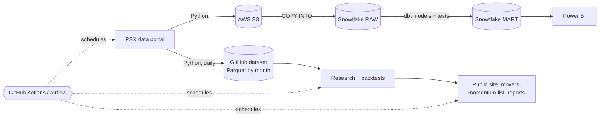

# PSX Market Data Platform

**Free, daily-updated Pakistan Stock Exchange data, plus the data platform and research built on it.**

🌐 **Live site:** https://shessols.github.io/psx-market-data-platform
📦 **Dataset:** [`dataset/`](dataset/), refreshed every weekday at 18:00 PKT by GitHub Actions




## Use the data

```python
import pandas as pd
base = "https://raw.githubusercontent.com/shessols/psx-market-data-platform/main/dataset"

latest = pd.read_csv(f"{base}/latest.csv")                  # most recent trading day
stocks = pd.read_csv(f"{base}/stocks.csv")                  # symbol, name, sector
oct26  = pd.read_parquet(f"{base}/prices/2026-10.parquet")  # one month of daily OHLCV
```

For the full history, clone the repo and read `dataset/prices/*.parquet`. `dataset/metadata.json` shows the date range, row count and last update.
Prices are **raw**. For long-term analysis, adjust for splits and bonus shares with `ingest/adjust_prices.py`.

## Research findings (KSE-100 stocks, 2017–2026)

| Monthly strategy | Per year | Worst drop |
|---|---|---|
| **Momentum: best 10 by 12-month return** | **~21%** | −40% |
| Whole market, equal weights | ~16% | −48% |
| Buying the worst 10 of the last 12 months | ~10% | −64% |

Buying Rs 1,000 a day of the day's biggest loser or gainer and holding was **no better than random picks**. Full results are on the [live site](https://shessols.github.io/psx-market-data-platform) and refresh daily. *Fees included, tax not. Not investment advice.*

## What this project shows

| Area | Tools | Where |
|---|---|---|
| Ingestion | Python, pandas, `psxdata`, retries, incremental loads | `ingest/update_dataset.py`, `ingest/extract_psx.py` |
| Data cleaning | Split/bonus back-adjustment using PSX price limits | `ingest/adjust_prices.py` |
| Data lake | AWS S3, Parquet, date partitions | `ingest/upload_s3.py`, `docs/aws_setup.md` |
| Warehouse | Snowflake, storage integration, `COPY INTO`, `MERGE` | `snowflake/`, `ingest/load_snowflake.py` |
| Transformation | dbt, SQL window functions, star schema | `dbt/models/` |
| Data quality | dbt tests (uniqueness, ranges, relationships, OHLC logic) | `dbt/models/schema.yml`, `dbt/tests/` |
| Orchestration | GitHub Actions (daily), Apache Airflow in Docker | `.github/workflows/`, `dags/` |
| Analytics | Power BI, DAX | `powerbi/` |
| Research | Backtests with fees and tax, random benchmark, rolling windows, momentum vs reversal | `backtest/` |
| Publishing | Daily movers chart, static site on GitHub Pages | `publish/` |
| Engineering | pytest, CI, config-driven, secrets via env vars | `tests/`, `config.yaml` |

## dbt models

| Model | Purpose |
|---|---|
| `stg_prices`, `stg_stocks` | Clean and deduplicate raw data |
| `dim_stock` | Name, sector, first/last trading day |
| `fct_daily_prices` | % change, gap, value traded, 20-day averages, limit flags |
| `mart_daily_movers` | Daily loser and gainer ranks among liquid stocks |
| `mart_sector_daily`, `mart_market_breadth` | Sector and market breadth |
| `mart_mover_forward_returns`, `mart_strategy_summary` | What happens after a stock is the day's #1 loser or gainer |

## Run it yourself

```bash
pip install -r requirements.txt
python ingest/update_dataset.py --full                      # all PSX history (takes a while)
python ingest/adjust_prices.py data/psx_daily.csv data/psx_daily_adj.csv
python backtest/research_monthly.py                         # momentum vs losers vs market
python backtest/backtest.py --data data/psx_daily_adj.csv   # Rs 1,000/day loser vs gainer
python publish/build_site.py                                # the website, in site/
```

Cloud setup (Snowflake, S3, Airflow): see `docs/aws_setup.md`, `snowflake/` and `docker-compose.yml`.

## Data notes

- Source: the PSX Data Portal (dps.psx.com.pk), collected with the open-source [psxdata](https://pypi.org/project/psxdata/) library, for education and research. PSX market data is PSX's property: redistribution needs PSX's permission (marketdatarequest@psx.com.pk). Please respect PSX's terms of use.
- Only currently listed companies are included, so backtests carry some survivorship bias.
- Nothing here is investment advice.

Built by **Abdullah Sherwani**: Data Analyst & Data Engineer · [LinkedIn](https://linkedin.com/in/shessols) · MIT License
